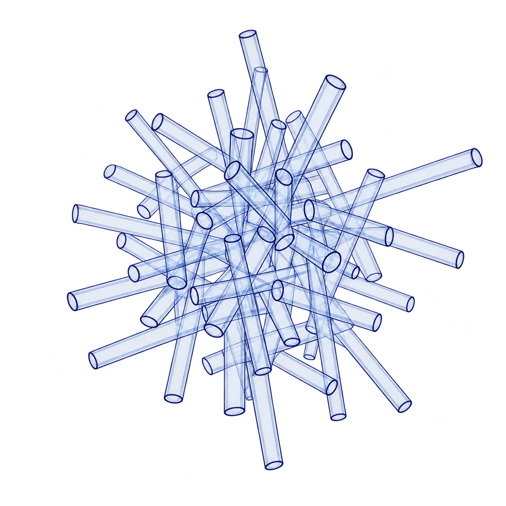

<div align="center">
  
  <h1>Workbench 4.0.0 · Goorul</h1>
  <p>打开文档，查找资料，编辑内容，导出可以继续使用的标准文件。</p>
</div>

[English](README.en.md) · [本版本下载页](https://github.com/wyzh0117/workbench/releases/tag/v4.0.0-Goorul)

## 这次改了什么

这是原有 Workbench 的桌面版改造，不是网页草图。沿用 Tauri 与原有文档解析、安全凭据、联网请求和导出底层，将界面收拢成一条流程：

**导入文档 → 可选 AI 解析 → 查找并阅读真实资料 → 选择、编辑章节与媒体 → 生成与导出。**

- **左侧**只有「媒体库」和「文件夹」两个入口，支持图片/视频预览和父文件夹导航。
- **中间**按章节编辑文字、图片、视频与来源链接，可调整顺序、复制和删除区块。
- **右侧**查找网页、图片或视频，在内嵌浏览/阅读区查看后插入。网站禁止嵌入时可使用安全正文阅读模式，不绕过网站限制。
- 两个侧栏都能收起、拖动调宽，也支持键盘调整。

旧版课程总览、任务收件箱、映射和发布中心不再出现在新的主界面中。仓库保留部分旧版底层与回归测试，以便安全复用与追踪历史。

## 安装

在[本版本下载页](https://github.com/wyzh0117/workbench/releases/tag/v4.0.0-Goorul)选择：

- **Windows x64**：`AI-Course-Workbench-Windows-x64-setup.exe`，运行安装向导。
- **macOS（Apple Silicon 和 Intel）**：`AI-Course-Workbench-macOS.dmg`，打开后将应用拖入 Applications。

安装包沿用原来的文件名和应用标识，便于识别与升级。实际签名、公证状态及首次打开方法以本版本发布页为准；不要关闭系统安全保护。下载页同时提供 SHA-256 校验文件。

## 第一次使用

1. 点击「导入」，选择 Markdown、TXT、DOCX、PDF 或 PPTX。原始二进制文档不会被改写。
2. 直接编辑正文；需要 AI 时先在「设置」填写自己服务商的 API 地址、协议、模型名称和密钥，再点击「AI 解析」。正文会发送给你配置的服务。
3. 在右侧选择网页、图片或视频搜索。图片使用真实 Wikimedia Commons；网页和视频分别需要配置 Brave Search / YouTube Data API。选中的 Commons PNG/JPEG 会下载到文档旁的普通媒体目录后插入，供 Word/PPT 真正嵌入；其他格式会明确提示。图片的授权与署名要求仍需自行核对。
4. 阅读来源后插入所需内容；本地媒体也可从左侧加入。
5. 保存为普通 Markdown（`.md`），或在「生成 / 导出」中导出 Markdown、HTML、Word（`.docx`）或 PowerPoint（`.pptx`）。

## 文件与边界

- **没有新的私有项目格式**：Markdown 是可继续编辑的标准文件；媒体使用普通文件或来源链接，不要求创建 `project.json`。
- DOCX/PDF/PPTX 导入侧重内容提取，不承诺无损保留复杂排版。扫描 PDF 没有可提取文字时会提示，不伪装成完成 OCR。
- PPTX 导出同时生成 **Markdown 样式说明**，描述实际设计语言、页面尺寸、字体、色彩、图片规则和后续加页指导，可交给其他模型继续匹配。
- 视频、网页及不能嵌入的媒体保留明确来源/链接；请查看导出警告。不能保证第三方网页允许内嵌或所有视频编码均能播放。
- API Key 使用已有平台安全存储，不进入正文、浏览器本地存储或导出文件。未配置/不可用时明确报错，本地编辑仍可继续；没有模拟的 AI 成功结果。
- 保存会检查磁盘文件是否被别的程序改过，冲突时停止覆盖。可通过「生成 / 导出」保存 Markdown 副本，或重新打开磁盘版本，避免丢失外部修改。
- 浏览器开发模式可真实导入、编辑和下载 Markdown，但文件夹、原生格式解析/导出、AI 和联网检索需桌面版。浏览器模式不是桌面版的替代交付。
- 原生 PDF 导出不在此版本的精简入口中；如需 PDF，可打开导出的 HTML 使用浏览器「打印 → 保存为 PDF」。

## 从源码验证与构建

需要 **Deno 2.9.6**、Rust stable、Tauri 2 CLI 和相应操作系统构建依赖。

```bash
deno task check
deno task test
cargo test --locked --manifest-path src-tauri/Cargo.toml
cargo tauri build
```

Linux 原生开发需 GTK 3 / WebKitGTK 4.1 等 Tauri 构建依赖。正式安装包继续提供 macOS Universal DMG 与 Windows x64 NSIS。云端或 CI 构建通过不等于已在用户的 Mac 上实机运行；验证证据与限制见发布说明。

新分支的 CI 会执行类型检查、回归测试、真实 Chromium 界面测试和双平台打包。只有明确标记的最终提交才创建 `v4.0.0-Goorul`，不移动主分支、不覆盖既有 tag 或已发布安装包。

## License

仓库目前没有 LICENSE 文件；本次改造不新增或推断原项目的使用、修改和再发布许可。
